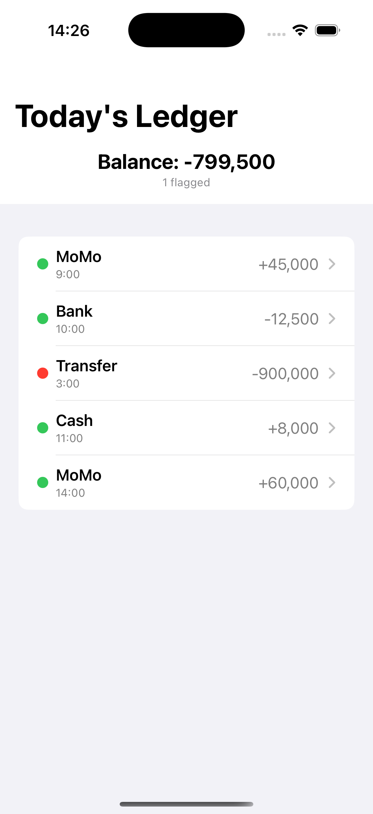
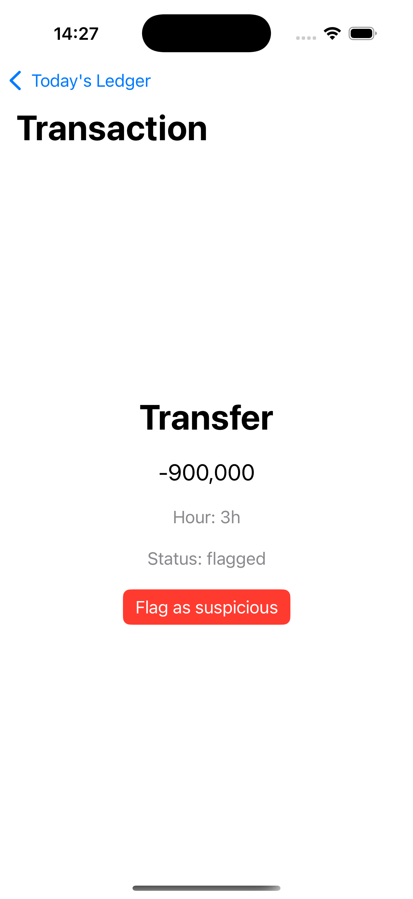

# Mini Project | SafiLedger


**A payments app for businesses and banks that tracks the day's transactions, keeps a running balance, and flags the ones that look suspicious.**

## Why SafiLedger
A growing business handles many payments a day: MoMo, cash and bank transfers. Nobody can check every one by hand, and a single missed fraudulent payment can mean money lost for good. SafiLedger watches the day's transactions and flags anything unusual, such as a huge transfer at 3am, so the owner can review it before it is too late.

## Screenshots
| Today's Ledger | Transaction detail |
|:---:|:---:|
|  |  |

## Features
- Daily transaction list, color-coded by status (green cleared, orange pending, red flagged)
- Live balance and flagged-count summary at the top of the screen
- Transaction detail screen with a "Flag as suspicious" action
- Fraud rules built into the model: a transaction looks suspicious if its amount is above 80,000 (money in or out) or if it happened before 5am
- Safe status lifecycle: pending, cleared, flagged, reversed, with guards that block illegal moves

## Architecture (MVVM)
| Layer | Files | Job |
|---|---|---|
| Model | `Transaction`, `TxStatus`, `Helpers` | What a transaction is, its status rules, and the fraud check |
| ViewModel | `LedgerViewModel` | Holds the live list, the balance and flagged count, and the flag action |
| View | `TransactionListView`, `TransactionDetailView` | Draws the screens and sends taps to the ViewModel |

The View never touches the Model directly. It asks the ViewModel, and the ViewModel updates the data.

## Project structure
```
SafiLedger/
├── Models/
│   ├── Transaction.swift
│   └── Helpers.swift
├── ViewModels/
│   └── LedgerViewModel.swift
├── Views/
│   ├── TransactionListView.swift
│   └── TransactionDetailView.swift
└── SafiLedgerApp.swift
```

## Getting started
Requires a Mac with Xcode.
1. Clone the repository
2. Open `SafiLedger.xcodeproj` in Xcode
3. Choose an iPhone simulator at the top
4. Press Cmd + R to run

## Roadmap
- [ ] Save transactions in the cloud with Firebase
- [ ] Sign-in so each user sees their own ledger
- [ ] Add a new transaction from inside the app

## Built with
Swift, SwiftUI, MVVM

## Author
Leiss Uwase, Student ID 27064
